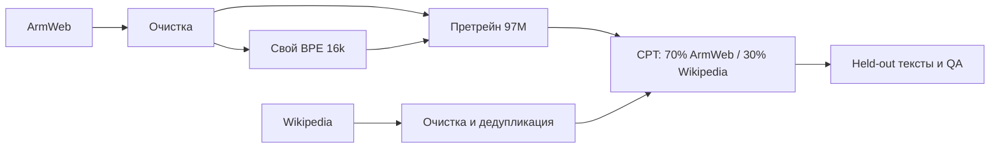

# Устройство проекта

## Путь модели

## Слои кода

| Пакет | Ответственность |
| :--- | :--- |
| [data](../src/armenian_llm/data/) | загрузка и очистка корпусов, кодирование ID, смешивание источников |
| [tokenization](../src/armenian_llm/tokenization/) | выборка train / validation, BPE, распределение частот |
| [modeling](../src/armenian_llm/modeling/) | GPT, RoPE, RMSNorm, causal attention и SwiGLU |
| [training](../src/armenian_llm/training/) | оптимизатор, шаги обучения, расписания, validation и checkpoint |
| [inference](../src/armenian_llm/inference/) | генерация следующего токена с temperature и top-k |
| [evaluation](../src/armenian_llm/evaluation/) | полная оценка loss и тест фактов с переформулировками |
| [reporting](../src/armenian_llm/reporting/) | сборка графиков, отчёта и архива для сдачи |
| [experiments](../src/armenian_llm/experiments/) | сравнение размеров и подбор micro batch |

Внутри пакета используются абсолютные импорты `armenian_llm.*`. В корне нет копий исполняемых модулей. CLI передаёт аргументы выбранному этапу; из Jupyter работают те же команды через `%run -m armenian_llm`.

## Данные и конфигурации

`paths.py` определяет корень репозитория и отдельное хранилище. Исходный корпус, бинарные потоки токенов и checkpoint находятся в `LLM_STORAGE_ROOT`. Настройки очистки, вопросы и параметры запусков хранятся в `configs/`. Небольшой обученный токенизатор включён в `assets/tokenizer/`.

## Снимки кода и checkpoint

Новые запуски сохраняют рядом с результатом целый `code/src/armenian_llm`, конфигурации и `pyproject.toml`. Снимок сохраняет пакетные импорты и может использоваться самостоятельно.

У старых запусков код лежит плоско в `code/model.py` и `code/generate.py`. Экспорт распознаёт обе схемы и записывает подходящую инструкцию загрузки. Названия тензоров и вычисления GPT при перестройке не менялись.

Проверка fingerprint при resume сохраняется. Для возобновления старого прерванного обучения нужен его исходный snapshot кода; для инференса можно использовать новый пакет.
